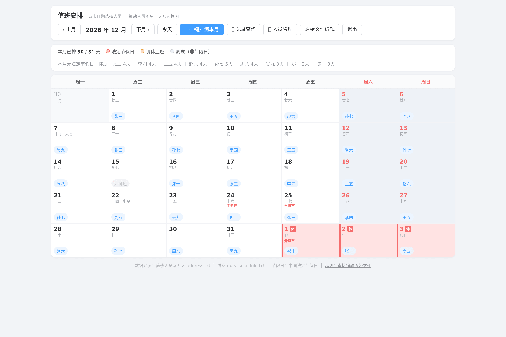
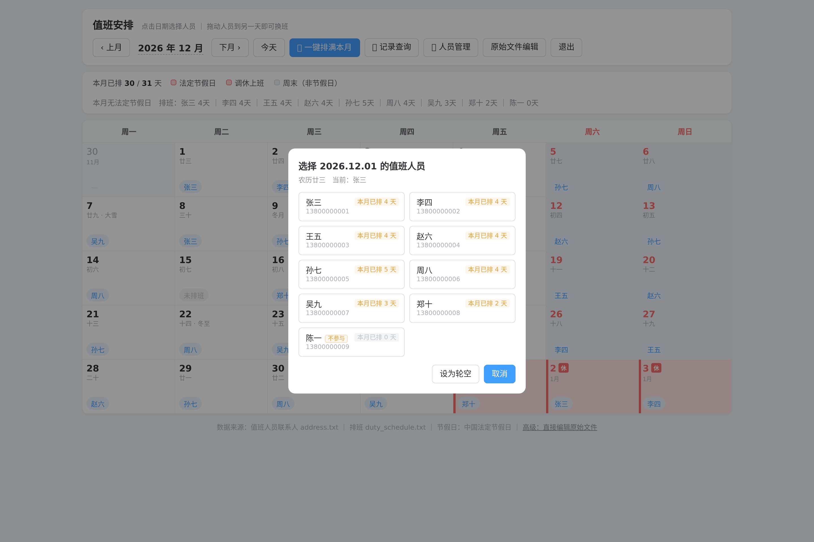
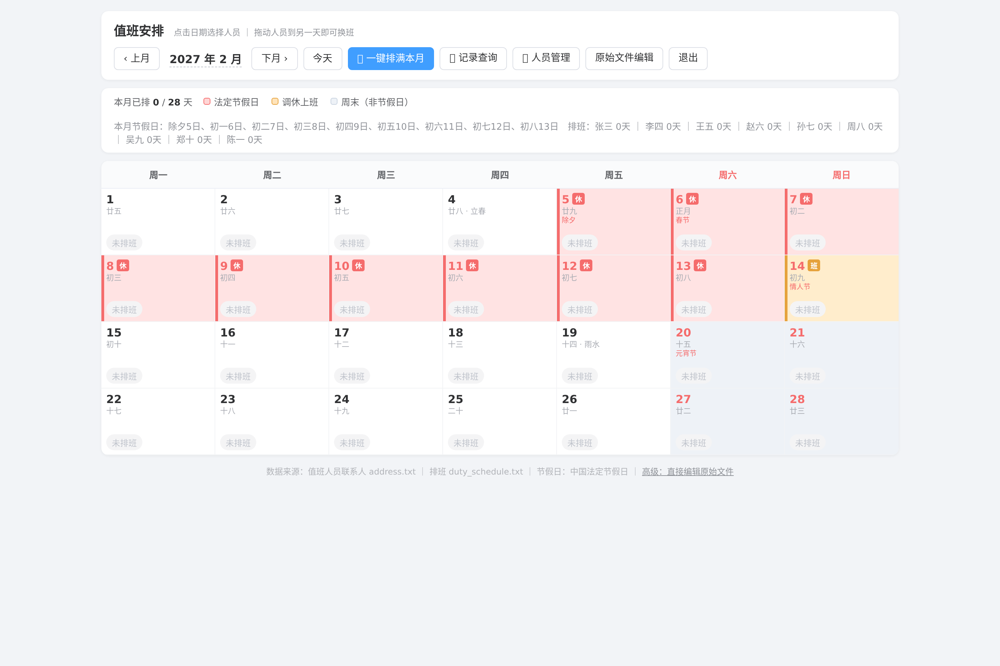
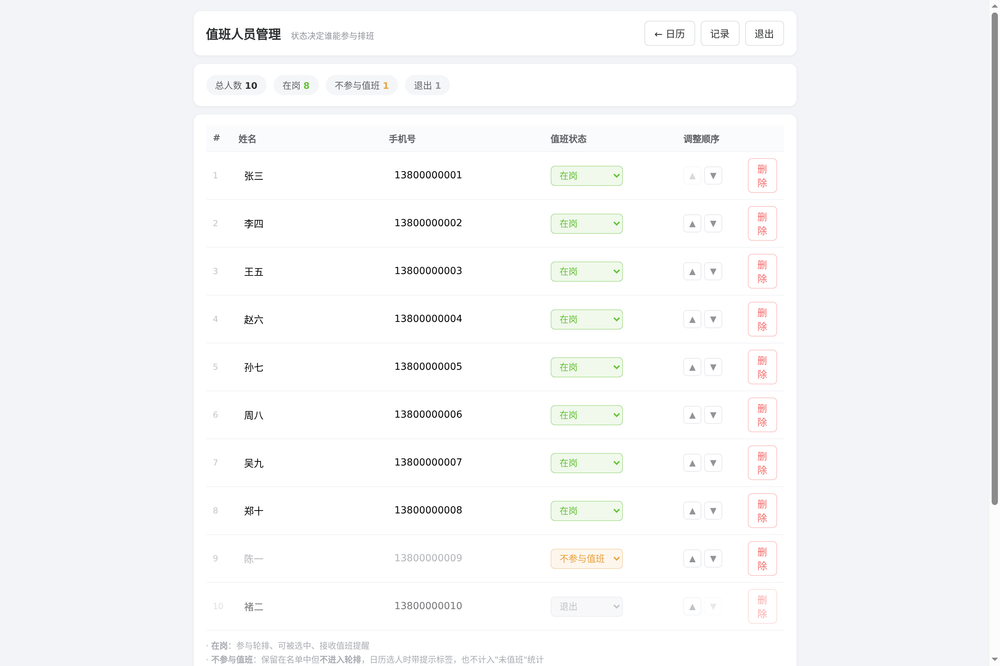
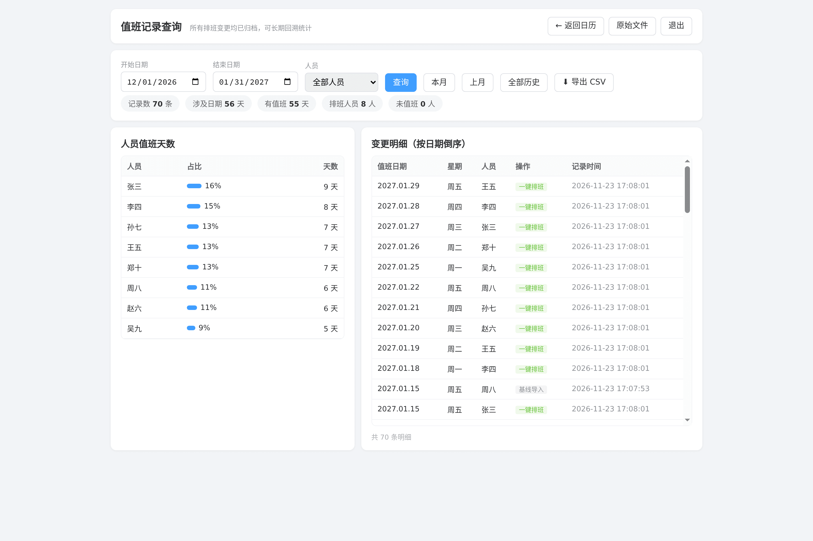

# 值班排班管理系统（Duty Schedule System）

> 一套面向小团队的**值班排班管理系统**：网页可视化排班日历 + 中国法定节假日/调休自动识别 + 钉钉群机器人定时提醒 + 值班记录长期归档与统计。纯文本文件存储，**无需数据库**，一台小服务器即可跑起来。

[](https://github.com/BKChuTang/duty-schedule-system/actions/workflows/ci.yml)


**Topics**：`duty-schedule` · `duty-roster` · `calendar` · `dingtalk` · `dingtalk-bot` · `dingtalk-robot` · `express` · `reminder` · `chinese-holidays` · `lunar-calendar` · `nodejs`

一套面向小团队的值班排班系统：**网页可视化排班** + **中国法定节假日识别** + **钉钉定时提醒** + **值班记录归档统计**。

不需要数据库，所有数据都是纯文本文件，可直接用编辑器查看/修改，也方便备份与版本管理。

```
浏览器 ──► /zb/  日历排班页（点选人员 / 拖拽换班 / 一键排满）
             │
             ├── /zb/contacts  人员管理（在岗 / 不参与值班 / 退出）
             ├── /zb/records   记录查询与统计（可导出 CSV）
             │
        Express 服务 ──► duty_schedule.txt（排班表）
                    ──► address.txt      （通讯录）
                    ──► duty_records.csv （变更归档，只增不减）
                    ▼
             node-schedule ──► 钉钉群机器人（每日提醒 / 周汇总 / 节假日前提醒）
```

---

## 界面预览

> 以下截图使用仓库内置的**脱敏样例数据**（人员为张三/李四……，手机号为 1380000000x），可直接对照样例文件查看效果。

### 排班日历



顶部为中文月份标题（点击可选择月份）、本月已排天数、节假日图例；格子内显示日期、农历、节日与值班人员，前后月份的过渡日期也会显示真实排班。
普通周末浅蓝灰、法定节假日粉红+`休`、调休上班琥珀+`班`，三级区分一目了然。

### 点选人员（显示每人本月已排天数）



点任意日期弹出人员列表，每人带「本月已排 N 天」，避免分配不均；未排过的人显示灰色 `0 天`。

### 法定节假日与调休识别



自动拉取公共节假日数据并本地缓存，识别春节等连续假期（`休`）与调休补班（`班`），顶部汇总本月全部节假日。

### 人员管理（三种状态）



行内修改姓名/手机号、切换「在岗 / 不参与值班 / 退出」、▲▼ 调整轮排顺序，保存自动备份。

### 值班记录查询与统计



按日期区间与人员筛选，展示每人值班天数占比与逐条变更明细，支持一键导出 CSV。

---

## 目录

- [界面预览](#界面预览)
- [功能特性](#功能特性)
- [快速开始](#快速开始)
- [数据文件格式](#数据文件格式)
- [配置说明](#配置说明)
- [使用说明](#使用说明)
- [提醒规则](#提醒规则)
- [API 接口](#api-接口)
- [部署到服务器（Nginx + PM2）](#部署到服务器nginx--pm2)
- [常见问题](#常见问题)
- [目录结构](#目录结构)
- [关于脱敏](#关于脱敏)
- [更新日志](#更新日志)
- [开源协议](#开源协议)

---

## 功能特性

### 📅 可视化排班日历

- 月历视图（周一开头），展示**农历、节气、传统节日**
- 自动标记**法定节假日**（红底 + `休`）与**调休上班**（橙底 + `班`），数据来自公共节假日接口并本地缓存
- 普通周末单独浅色底色，与节假日/调休三级区分
- **点选日期**即可指定值班人员，面板内显示每人「本月已排 N 天」，避免分配不均
- **拖拽换班**：把某人拖到另一天 —— 目标是已排人员则两者互换，是空白则等同于移过去
- **一键排满**：按通讯录顺序自动接续轮排整月，可勾选跳过周末/跳过法定节假日/是否覆盖已有排班
- 前后月份的过渡日期也会显示真实排班，跨月排班一目了然
- 本月统计：已排 X/Y 天、节假日汇总、每人值班天数

### 👥 人员管理（三种状态）

| 状态 | 一键排班 | 日历选人 | 未值班统计 |
|---|---|---|---|
| **在岗** | ✅ 参与轮排 | ✅ 显示 | ✅ 计入 |
| **不参与值班** | ❌ 跳过 | ⚠️ 显示但带「不参与」标签 | ❌ 不计 |
| **退出** | ❌ 跳过 | ❌ 隐藏 | ❌ 不计 |

支持行内修改姓名/手机号、上下移动调整**轮排顺序**、增删人员，保存时自动备份原文件。

### 📊 值班记录归档与统计

- 每一次排班变更（手动设置、换班、一键排班、设为轮空）都会**追加**写入 `duty_records.csv`，只增不减
- 查询页支持按日期区间、按人员筛选，展示人员值班天数与占比条形图
- 统计规则：同一天存在多条记录时以**最后一条**为准，换班不会导致人次虚高
- 一次点击导出 CSV（带 BOM，Excel 打开中文不乱码）

### 🔔 钉钉定时提醒

- **每日 9:00** 推送当日值班人员（@ 对应手机号）
- **每周一** 额外推送本周 7 天值班汇总
- **每周五** 推送周末（周六、周日）值班预告
- **法定节假日前一天** 推送整个连续假期的值班安排
- 支持 `DUTY_DRYRUN=1` 试运行：只打印消息不真实发送，方便验证文案

---

## 快速开始

### 环境要求

- Node.js **≥ 18**（推荐 20+）
- 可选：PM2（守护进程）、Nginx（反向代理 + HTTPS）

### 安装

```bash
git clone https://github.com/BKChuTang/duty-schedule-system.git
cd duty-schedule-system
npm install
```

### 准备数据文件

```bash
# 通讯录（真实姓名+手机号）
cp address.sample.txt address.txt

# 排班表
cp duty_schedule.sample.txt duty_schedule.txt
```

> `address.txt` 与 `duty_schedule.txt` 已在 `.gitignore` 中，不会被误提交。

### 配置

**只需要改一个文件：项目根目录下的 `.env`**（从同目录的 `.env.example` 复制而来）。

```bash
cp .env.example .env        # ← 生成 /你的项目路径/.env
vi .env                     # 至少填下面三项
```

打开后必须改这 3 行：

```ini
DINGTALK_WEBHOOK_URL=https://oapi.dingtalk.com/robot/send?access_token=你的机器人token
ZB_PASSWORD=你的登录密码
COOKIE_SECRET=随便一长串随机字符
```

> 用 PM2 托管时，在 `ecosystem.config.js`（由 `ecosystem.config.example.js` 复制）的 `env` 段填同样的变量也可以。
> 变量全表、优先级与 PM2 写法见[配置说明](#配置说明)。

### 启动

```bash
# 方式一：直接运行两个服务
node file-editor.js     # Web 编辑器，默认 http://localhost:8080/zb/
node workday.js         # 定时提醒服务

# 方式二：PM2 托管（推荐）
cp ecosystem.config.example.js ecosystem.config.js   # 按需改路径与凭据
pm2 start ecosystem.config.js
pm2 save
```

打开 `http://localhost:8080/zb/`，输入 `ZB_PASSWORD` 即可进入日历。

### 验证钉钉连通性

```bash
DINGTALK_WEBHOOK_URL='https://oapi.dingtalk.com/robot/send?access_token=xxx' \
  node scripts/test-dingtalk.js
```

### 试运行提醒（不真实发送）

```bash
DUTY_DRYRUN=1 node -e "
const w = require('./workday.js');
w.sendHolidayEveReminder && w.sendHolidayEveReminder(new Date());
"
```

---

## 数据文件格式

### `address.txt` — 值班人员通讯录

每行一条，**逗号分隔三列**：

```
姓名,手机号,状态
```

| 列 | 说明 |
|---|---|
| 姓名 | 必须与排班表里的姓名**完全一致**（含空格差异也不行） |
| 手机号 | 钉钉 @ 提醒用，需与钉钉账号绑定号码一致；留空则该人不被 @ |
| 状态 | `在岗` / `不参与值班` / `退出`；**缺省视为在岗**（兼容两列旧格式） |

示例（`address.sample.txt`）：

```
张三,13800000001,在岗
李四,13800000002,在岗
陈一,13800000009,不参与值班
褚二,13800000010,退出
```

> 文件中的**行序 = 一键排班的轮排顺序**，可用页面的 ▲▼ 调整。

### `duty_schedule.txt` — 排班表

每行一天，格式：

```
YYYY.MM.DD, 姓名
```

示例：

```
2026.12.01, 张三
2026.12.02, 李四
```

- 日期必须零填充（`2026.01.05` 而非 `2026.1.5`）
- 姓名留空或整行缺失 = 当天无人值班
- 文件更新后提醒服务会自动重载（PM2 `watch`）

### `duty_records.csv` — 变更归档（程序自动维护）

```
recorded_at,date,person,action,note
```

| action | 含义 |
|---|---|
| `import` | 首次启用时的基线导入 |
| `set` | 手动指定人员 |
| `clear` | 设为轮空 |
| `swap` | 拖拽换班（两天各一条） |
| `autofill` | 一键排班批量写入 |

该文件只追加不修改，可长期保留用于年终统计（每人每年值班天数等）。

### `holidays-cache.json` — 节假日缓存（程序自动维护）

按年缓存，7 天自动刷新；网络异常时回退旧缓存，不影响页面使用。可删除，删了会重新拉取。

---

## 配置说明

**不需要改任何 `.js` 代码**。配置只有两个位置，按你是否用 PM2 选一个：

| # | 要修改的文件 | 完整路径 | 什么时候用 |
|---|---|---|---|
| 1 | **`.env`** | `<项目目录>/.env`（由 `<项目目录>/.env.example` 复制） | 直接用 `node file-editor.js` / `node workday.js` 启动，**推荐** |
| 2 | `ecosystem.config.js` | `<项目目录>/ecosystem.config.js`（由 `ecosystem.config.example.js` 复制） | 用 PM2 托管时，在 `env` 段写同样的变量 |

> `<项目目录>` 就是你 `git clone` 下来的目录，例如 `/opt/duty-schedule-system`。

### 第 1 步：复制模板文件

```bash
cd /opt/duty-schedule-system                  # 换成你的项目目录
cp .env.example .env                          # ← 这个就是要改的配置文件
cp ecosystem.config.example.js ecosystem.config.js   # 仅用 PM2 时需要
```

`.env` 与 `ecosystem.config.js` 都已在 `.gitignore` 中，不会被误提交。

### 第 2 步：修改 `.env`（必改 3 项）

| 变量 | 改成什么 | 不改的后果 |
|---|---|---|
| `DINGTALK_WEBHOOK_URL` | 你的钉钉群机器人 Webhook | 提醒一条都发不出去 |
| `ZB_PASSWORD` | 你的登录密码 | 任何知道默认密码的人都能改排班 |
| `COOKIE_SECRET` | 一串随机长字符 | 登录 Cookie 可被伪造 |

```ini
# ===== 必改 =====
DINGTALK_WEBHOOK_URL=https://oapi.dingtalk.com/robot/send?access_token=你的机器人token
ZB_PASSWORD=你的登录密码
COOKIE_SECRET=fd8s7a9f8sd7fa9s8df7a9s8df

# ===== 可选 =====
DAILY_CRON=0 9 * * *
PORT=8080
BASE_PATH=/zb
TZ=Asia/Shanghai
```

### 第 3 步：完整变量表

| 变量 | 默认值 | 作用文件 | 说明 |
|---|---|---|---|
| `DINGTALK_WEBHOOK_URL` | 示例占位 | `workday.js` | 钉钉群机器人 Webhook，**必改** |
| `DAILY_CRON` | `0 9 * * *` | `workday.js` | 每日提醒时间（cron 表达式） |
| `DUTY_SCHEDULE_FILE` | `./duty_schedule.txt` | `workday.js` | 排班表路径（相对项目根目录） |
| `ADDRESS_FILE` | `./address.txt` | `workday.js` | 通讯录路径（相对项目根目录） |
| `DUTY_DRYRUN` | 未设置 | `workday.js` | 设为 `1` 时提醒只打印不发送，用于验证文案 |
| `PORT` | `8080` | `file-editor.js` | Web 编辑器监听端口 |
| `BASE_PATH` | `/zb` | `file-editor.js` | 访问路径前缀，即 `http://IP:8080/zb/` |
| `ZB_PASSWORD` | `change-me` | `file-editor.js` | 日历/人员/记录页面的登录密码，**必改** |
| `COOKIE_SECRET` | `change-this-cookie-secret` | `file-editor.js` | 登录 Cookie 签名密钥，**必改** |
| `HERMES_PASSWORD` | `change-me-too` | `file-editor.js` | 可选：Hermes 反代页面密码，不用可忽略 |
| `HERMES_TARGET` | `http://127.0.0.1:9119` | `file-editor.js` | 可选：Hermes 反代目标地址 |
| `HERMES_PATH` | `/hermes` | `file-editor.js` | 可选：Hermes 反代路径前缀 |

### 三种生效方式（优先级从高到低）

1. **系统/命令行环境变量**（最高）：
   ```bash
   DINGTALK_WEBHOOK_URL='https://...' ZB_PASSWORD='你的密码' node file-editor.js
   ```
2. **项目根目录 `.env` 文件**（推荐，`npm install` 已包含 dotenv）：
   ```bash
   npm install     # 会装 dotenv
   node file-editor.js    # 自动读取根目录 .env
   ```
   不想装 dotenv 时，Node 20+ 也可显式指定：`node --env-file=.env file-editor.js`
3. **代码内默认值**（最低，仅够本地试跑）：`change-me` 之类，**生产环境务必覆盖**。

### 用 PM2 启动时怎么配

改 `ecosystem.config.js` 里 `duty-reminder` 与 `duty-file-editor` 两个 app 的 `env` 段：

```js
env: {
  NODE_ENV: 'production',
  TZ: 'Asia/Shanghai',
  PORT: 8080,
  DINGTALK_WEBHOOK_URL: 'https://oapi.dingtalk.com/robot/send?access_token=你的机器人token',
  ZB_PASSWORD: '你的登录密码',
  COOKIE_SECRET: '随便一长串随机字符'
}
```

改完执行：

```bash
pm2 restart ecosystem.config.js --update-env
pm2 save
```

### 获取钉钉 Webhook

钉钉群 → 群设置 → 智能群助手 → 添加机器人 → 自定义 → 安全设置（建议勾「自定义关键词」并填 `值班`）→ 复制 Webhook 地址，形如：

```
https://oapi.dingtalk.com/robot/send?access_token=abcdef1234567890
```

可先用 `node scripts/test-dingtalk.js` 验证连通性。

---

## 使用说明

### 排班

1. 打开 `/zb/`，用月份选择器切到目标月份
2. 点击任意日期 → 弹出人员列表（含「本月已排 N 天」）→ 点人即排
3. 或点「一键排满」→ 选择起始人、是否跳过周末/节假日 → 自动排满整月
4. 需要临时调整：直接**把人员标签拖到另一天**（互换/移动）

### 人员管理

`/zb/contacts`：
- 行内修改姓名、手机号
- 下拉切换状态（在岗 / 不参与值班 / 退出）
- ▲▼ 调整轮排顺序
- 底部添加新成员，右上角「保存全部」生效（自动备份原文件）

### 记录查询

`/zb/records`：
- 日期区间 + 人员筛选，快捷按钮「本月 / 上月 / 全部历史」
- 左侧人员值班天数排行，右侧变更明细（按日期倒序）
- 「⬇ 导出 CSV」导出当前筛选结果

---

## 提醒规则

| 触发时机 | 内容 |
|---|---|
| 每天 9:00（`DAILY_CRON`） | 今日值班人员 + 农历/节日 + @ 手机号 |
| 每周一 9:00 | 本周 7 天值班安排汇总 |
| 每周五 9:00 | 周六、周日值班预告 |
| 法定节假日前一天 9:00 | 整个连续假期（至多 15 天）的值班安排 |

节假日前提醒的触发条件为「**明天开始放假且今天不放假**」，因此不会在假期中途重复推送。

所有消息通过钉钉群机器人发送，支持 `DUTY_DRYRUN=1` 预览文案。

---

## API 接口

均为 `GET`/`POST` JSON，需先登录（Cookie 会话）。

| 方法 | 路径 | 说明 |
|---|---|---|
| `POST` | `/zb/login` | 登录（`password=xxx`） |
| `GET` | `/zb/api/data?year=&month=` | 月度日历数据（含前后月过渡日期、排班、通讯录） |
| `POST` | `/zb/api/set` | 设置某天值班人员 `{date, person}` |
| `POST` | `/zb/api/swap` | 换班 `{a, b}`（b 为空则等同于移动） |
| `POST` | `/zb/api/autofill` | 一键排班 `{year, month, startPerson, skipWeekend, skipHoliday, overwrite}` |
| `GET` | `/zb/api/contacts` | 通讯录与状态统计 |
| `POST` | `/zb/api/contacts/save` | 保存通讯录 `{contacts: [{name, mobile, status}]}` |
| `GET` | `/zb/api/records?from=&to=&person=` | 归档记录与统计 |
| `GET` | `/zb/api/records.csv?from=&to=&person=` | 导出 CSV |

---

## 部署到服务器（Nginx + PM2）

```bash
# 1. 目录与日志
sudo mkdir -p /var/log/duty-reminder
sudo chown $USER /var/log/duty-reminder

# 2. 安装依赖并启动
npm install
cp ecosystem.config.example.js ecosystem.config.js   # 修改 cwd 与登录密码
pm2 start ecosystem.config.js
pm2 save
pm2 startup   # 开机自启
```

Nginx 反向代理示例（`/etc/nginx/conf.d/duty.conf`）：

```nginx
server {
    listen 443 ssl http2;
    server_name your-domain.com;

    ssl_certificate     /etc/letsencrypt/live/your-domain.com/fullchain.pem;
    ssl_certificate_key /etc/letsencrypt/live/your-domain.com/privkey.pem;

    location /zb/ {
        proxy_pass http://127.0.0.1:8080;
        proxy_set_header Host              $host;
        proxy_set_header X-Real-IP         $remote_addr;
        proxy_set_header X-Forwarded-For   $proxy_add_x_forwarded_for;
        proxy_set_header X-Forwarded-Proto $scheme;
    }
}
```

修改配置后先 `nginx -t` 校验，再 `nginx -s reload`。

---

## 常见问题

**Q：页面打不开 / 一直跳登录页？**
检查 `duty-file-editor` 进程是否在运行（`pm2 list`），端口是否被占用（`ss -lntp | grep 8080`），以及反代路径 `/zb/` 是否带尾斜杠。

**Q：钉钉消息没收到？**
1. 用 `scripts/test-dingtalk.js` 单独测 Webhook
2. 检查机器人「安全设置」的关键词/加签/IP 白名单
3. 钉钉返回 `310000` 一般是关键词不匹配，`300001` 是 token 无效

**Q：@ 不到某人？**
`address.txt` 里的手机号必须与该人**钉钉绑定手机号一致**，且此人在群内。

**Q：一键排班跳过了某人？**
检查 `address.txt` 第三列状态，只有「在岗」参与轮排。

**Q：农历/节气不显示？**
依赖可选包 `lunar-javascript`，缺失时日历会正常降级（不显示农历，不报错）。执行 `npm install` 即可。

**Q：修改数据文件后要重启吗？**
PM2 配置里 `watch: ['./*.txt']` 会自动重启提醒服务；`.js` 与 `.html` 改动需 `pm2 restart`。

**Q：如何备份？**
整个目录的 `*.txt` + `duty_records.csv` 就是全部数据，定时 `tar` 打包即可。

---

## 目录结构

```
.
├── workday.js               # 定时提醒服务（钉钉推送 + 节假日判断）
├── file-editor.js           # Web 服务：登录、页面路由、静态资源、可选 Hermes 反代
├── calendar-routes.js       # 日历 API：数据、设置、换班、一键排班、通讯录
├── duty-records.js          # 归档模块：追加记录、查询、统计、导出
├── static/
│   ├── calendar.html        # 排班日历页
│   ├── contacts.html        # 人员管理页
│   └── records.html         # 记录查询页
├── scripts/
│   └── test-dingtalk.js     # 钉钉连通性测试
├── address.sample.txt       # 通讯录样例
├── duty_schedule.sample.txt # 排班表样例
├── duty_records.sample.csv  # 归档样例
├── docs/screenshots/        # README 界面截图
├── ecosystem.config.example.js  # PM2 配置样例（复制为 ecosystem.config.js 使用）
├── .env.example             # 环境变量样例
├── LICENSE                  # MIT
└── README.md
```

运行时生成/需要自备：`address.txt`、`duty_schedule.txt`、`duty_records.csv`、`holidays-cache.json`。

---

## 关于脱敏

本仓库所有示例数据均为**虚构**：

- 人员姓名：张三、李四、王五……（原项目真实姓名已全部替换）
- 手机号：`13800000001` ~ `13800000010`（原真实号码已全部替换）
- 钉钉机器人：Webhook 中的 `access_token` 替换为 `YOUR_DINGTALK_ACCESS_TOKEN` 占位符
- 登录密码、Cookie 密钥：替换为 `change-me` 等占位值，并改为通过环境变量注入
- 域名：`https://your-domain.com`（原站点域名已移除）

如需使用，请把上述占位值替换为自己的真实配置，并**不要**把含真实凭据的文件提交到仓库（`.gitignore` 已做拦截）。

---

## 更新日志

见 [CHANGELOG.md](CHANGELOG.md)。

## 开源协议

[MIT](LICENSE) © 2026 duty-schedule-system contributors

可自由使用、修改、分发，包括商业用途，保留版权声明即可。
